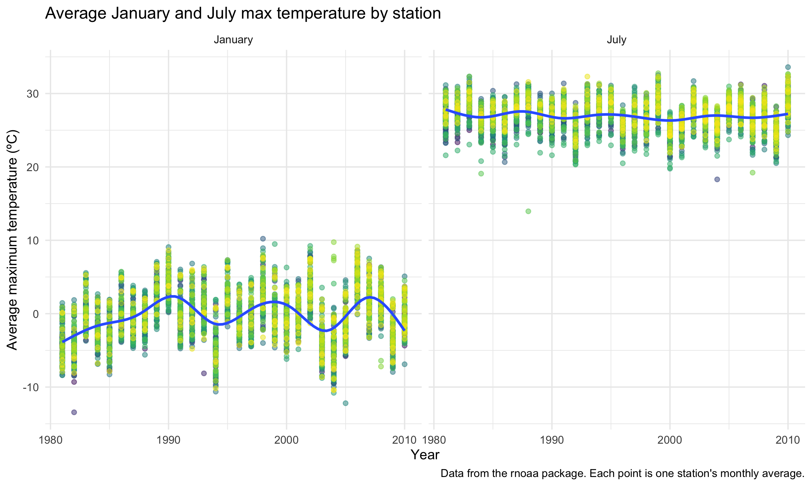
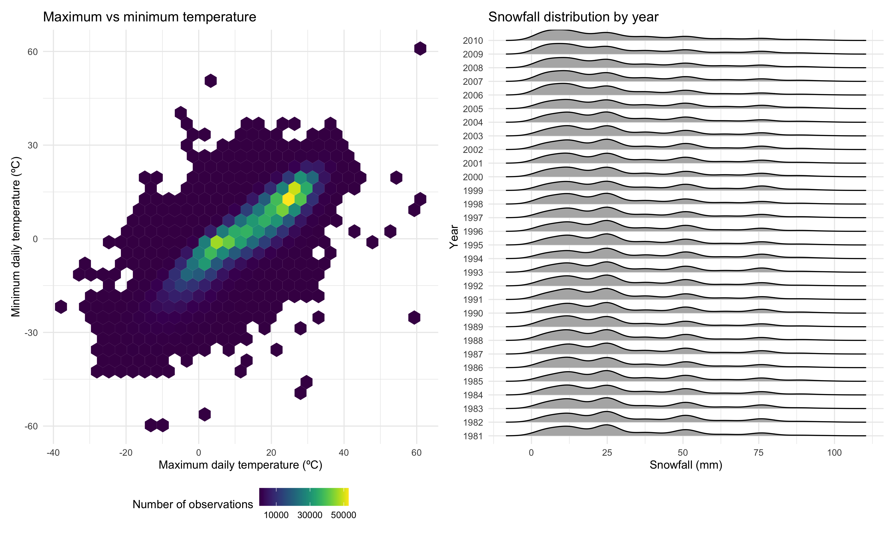
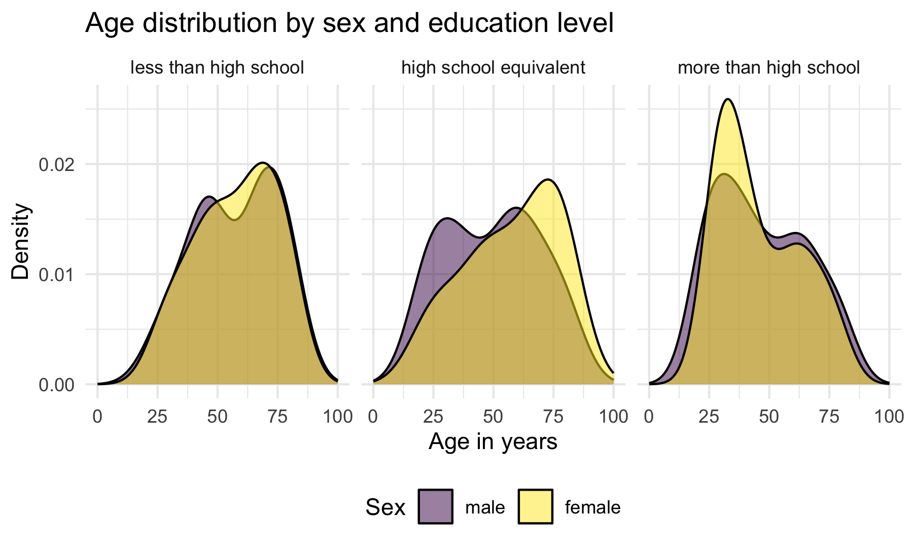

p8105_hw3_nel2139
================
Nicole Lewis
2026-10-15

## Problem 1

Load dataset

``` r
data("ny_noaa")
ny_noaa
```

    ## # A tibble: 2,595,176 × 7
    ##    id          date        prcp  snow  snwd tmax  tmin 
    ##    <chr>       <date>     <int> <int> <int> <chr> <chr>
    ##  1 US1NYAB0001 2007-11-01    NA    NA    NA <NA>  <NA> 
    ##  2 US1NYAB0001 2007-11-02    NA    NA    NA <NA>  <NA> 
    ##  3 US1NYAB0001 2007-11-03    NA    NA    NA <NA>  <NA> 
    ##  4 US1NYAB0001 2007-11-04    NA    NA    NA <NA>  <NA> 
    ##  5 US1NYAB0001 2007-11-05    NA    NA    NA <NA>  <NA> 
    ##  6 US1NYAB0001 2007-11-06    NA    NA    NA <NA>  <NA> 
    ##  7 US1NYAB0001 2007-11-07    NA    NA    NA <NA>  <NA> 
    ##  8 US1NYAB0001 2007-11-08    NA    NA    NA <NA>  <NA> 
    ##  9 US1NYAB0001 2007-11-09    NA    NA    NA <NA>  <NA> 
    ## 10 US1NYAB0001 2007-11-10    NA    NA    NA <NA>  <NA> 
    ## # ℹ 2,595,166 more rows

Data prep for summary

``` r
n_stations = 
  ny_noaa |>
  summarize(n_stations = n_distinct(id))

ny_noaa |> 
  mutate(
    tmax = as.numeric(tmax),
    tmin = as.numeric(tmin)) |> 
  pivot_longer(
    prcp:tmin,
    names_to = "variable",
    values_to = "value") |> 
  group_by(variable) |> 
  summarize(
    n_obs = n(),
    n_missing = sum(is.na(value)),
    pct_missing = n_missing / n_obs * 100) |> 
  knitr::kable(digits = 1)
```

| variable |   n_obs | n_missing | pct_missing |
|:---------|--------:|----------:|------------:|
| prcp     | 2595176 |    145838 |         5.6 |
| snow     | 2595176 |    381221 |        14.7 |
| snwd     | 2595176 |    591786 |        22.8 |
| tmax     | 2595176 |   1134358 |        43.7 |
| tmin     | 2595176 |   1134420 |        43.7 |

The `ny_noaa` dataset contains daily weather data for all New York State
weather stations from January 1, 1981 to December 31, 2010, from NOAA’s
GHCN-Daily database. It has 2595176 rows and 7 columns, where each row
represents one day of observations at one weather station. The data
include observations from 747 different weather stations. The dataset
includes the following variables: `id` (weather station ID), `date`
(date of observation), `prcp` (precipitation, in tenths of mm), `snow`
(snowfall, in mm), `snwd` (snow depth, in mm), `tmax` (maximum
temperature, in tenths of degrees C), and `tmin` (minimum temperature,
in tenths of degrees C).

Missing data is a significant issue in this dataset. Precipitation
(`prcp`) is the most complete variable, with only 5.6% of values
missing, followed by snowfall (`snow`) (14.7% missing) and snow depth
(`snwd`) (22.8% missing). Temperature has the most missing data, with
43.7% of both maximum (`tmax`) and minimum (`tmin`) temperature values
missing.

Data cleaning

``` r
data("ny_noaa")
ny_noaa = 
  ny_noaa |>
  mutate(
    tmax = as.numeric(tmax) / 10, 
    tmin = as.numeric(tmin) / 10, 
    prcp = prcp / 10) |> 
  separate(date, into = c("year", "month", "day"), sep = "-") |> 
  mutate(
    year = as.numeric(year), 
    month = as.numeric(month),
    day = as.numeric(day)
  )

ny_noaa |> 
  drop_na(snow) |> 
  count(snow, name = "n_obs") |> 
  filter(min_rank(desc(n_obs)) <= 5) |> 
  arrange(desc(n_obs)) |> 
  knitr::kable()
```

| snow |   n_obs |
|-----:|--------:|
|    0 | 2008508 |
|   25 |   31022 |
|   13 |   23095 |
|   51 |   18274 |
|   76 |   10173 |

In the cleaning process, the date variable was split into 3 separate
variables; `year`, `month`, and `day` and converted from character to
numeric variables so they can be easily filtered, grouped and plotted.
This added 2 more columns so the dataset has 2595176 rows and 9 columns,
where each row represents one day of observations at one weather
station. Maximum and minimum temperature variables were originally
stored as character variables in tenths of degrees Celsius and were
converted to numeric and divided by 10 so the units are now in degrees
Celsius. Precipitation was converted from tenths of millimeters to
millimeters to maintain consistency with the snow fall and snow depth
variable units.

After removing missing values, the most commonly observed snowfall value
is 0 mm (2,008,508 observations). This makes sense given that the
dataset includes observations for every day of the year, but snow
typically falls during the winter months in New York. Even during the
winter, many days have no snowfall, so it is reasonable for a large
number of days to have 0 mm of snow. The next most common values are 25
mm of snow (31,022 observations), 13 mm (23,095 observations), 51 mm
(18,274) and 76 mm (10,173). This pattern may reflect how snowfall is
typically measured in the United States, including New York, which uses
the imperial system, where measurements are recorded in inches. To
convert inches to millimeters, the number of inches is multiplied by
25.4 (since 1 inch = 25.4 mm) and rounded to the nearest whole
millimeter, which may cause many measurements to end up at the same few
values. Notably, the most frequently observed values of 25, 13, 51, and
76 mm correspond approximately to 1, 0.5, 2, and 3 inches, respectively.
These rounding and conversion practices may explain why observations
cluster at these specific values.

`tmax` two-panel plot

``` r
ny_noaa |> 
  drop_na(tmax) |>  
  select(id, year, month, tmax) |> 
  filter(month == 1 | month == 7) |> 
  group_by(id, year, month) |> 
  summarize(mean_tmax = mean(tmax)) |> 
  mutate(
    month = case_when(
      month == 1 ~ "January",
      month == 7 ~ "July")
  ) |> 
  ggplot(aes(x = year, y = mean_tmax)) +
  geom_point(aes(color = id), alpha = .5) +
  geom_smooth(se = FALSE) +
  facet_grid(~month) + 
  labs(
    title = "Average January and July max temperature by station",
    x = "Year",
    y = "Average maximum temperature (ºC)",
    caption = "Data from the rnoaa package. Each point is one station's monthly average."
  ) +
  theme(legend.position = "none")
```



Average maximum temperatures were much higher in July than in January.
January temperatures fluctuated considerably from year to year, ranging
mostly from about -10 to 10ºC, while July temperatures remained
relatively stable around 26ºC across the 30-year period. Within each
year, stations tended to rise and fall together, suggesting that warmer
or colder months affected the whole state. A few outliers stood out,
most notably one station in July around 1988 with an average maximum
temperature of about 14ºC, well below all other stations that month.
Other outliers included a July value of about 18ºC around 2004 and
January values near -13ºC around 1982 and -12ºC around 2005.

`tmax` vs `tmin` and snowball two-panel plot

``` r
ggp_tmax_tmin = 
  ny_noaa |> 
  drop_na(tmax, tmin) |> 
  ggplot(aes(x = tmax, y = tmin)) + 
  geom_hex() +
  viridis::scale_fill_viridis(breaks = c(10000, 30000, 50000)) + 
  labs(
    title = "Maximum vs minimum temperature",
    x = "Maximum daily temperature (ºC)",
    y = "Minimum daily temperature (ºC)", 
    fill = "Number of observations"
  ) 

ggp_snow = 
  ny_noaa |> 
  drop_na(snow) |> 
  filter(snow > 0, snow < 100) |> 
  mutate(year = factor(year)) |> 
  ggplot(aes(x = snow, y = year)) + 
  geom_density_ridges(scale = .85) + 
  labs(
    title = "Snowfall distribution by year",
    x = "Snowfall (mm)",
    y = "Year") +
  scale_x_continuous(
    breaks = c(0, 25, 50, 75, 100)
  )

ggp_tmax_tmin + ggp_snow
```



A hexbin plot (left) was used to graph `tmax` vs `tmin` as the dataset
contains a large number of observations which would cause substantial
overlap in a scatterplot. By grouping observations into hexagons and
using colour to represent their frequency, the hexbin plot makes it
easier to identify patterns and areas of high concentration. The plot
shows a strong positive relationship between maximum and minimum daily
temperatures, where days with higher maximum temperatures also tended to
have higher minimum temperatures. Most observations fell within a
diagonal pattern ranging from maximum temperatures of about 0 to 30ºC
and minimum temperatures of about -5 to 20ºC. A few isolated hexagons
are also visible, representing less common temperature combinations.
Examples of these include a maximum temperature value around 60ºC and
minimum temperature values around 60ºC and -60ºC, which are unrealistic
for New York weather conditions. A ridge plot (right) was used to show
the distribution of snowfall values between 0 and 100 mm for each year,
as it allows the shape of the distribution to be compared across all 30
years. The distributions are fairly similar from 1981 to 2010, with most
snowfall amounts below 30 mm and distinct peaks around 13, 25, 51, and
76 mm, which correspond to about 0.5, 1, 2, and 3 inches. In the most
recent years (around 2006-2010), the peak near 10 mm was more pronounced
while the 25 mm peak was smaller, suggesting that smaller snowfall
amounts were more often recorded in those years.

## Problem 2

Load demographic and accelertor datasets and create combined dataset

``` r
demo_df = 
  read_csv("./data/nhanes_covar.csv", na = c("NA"), skip = 4) |> 
  janitor::clean_names() |> 
  filter(age >= 21) |> 
  drop_na() |> 
  mutate(sex = recode(sex, `1` = "male", `2` = "female"),
         sex = factor(sex, levels = c("male", "female")),
         education = recode(
           education, 
           `1` = "less than high school",
           `2` = "high school equivalent",
           `3` = "more than high school"),
         education = factor(
           education, 
           levels = c("less than high school", "high school equivalent", "more than high school")
         ))
```

    ## Rows: 250 Columns: 5
    ## ── Column specification ────────────────────────────────────────────────────────
    ## Delimiter: ","
    ## dbl (5): SEQN, sex, age, BMI, education
    ## 
    ## ℹ Use `spec()` to retrieve the full column specification for this data.
    ## ℹ Specify the column types or set `show_col_types = FALSE` to quiet this message.

``` r
accel_df = 
  read_csv("./data/nhanes_accel.csv") |> 
  janitor::clean_names() |> 
  pivot_longer(
    min1:min1440,
    names_to = "minute", 
    names_prefix = "min",
    values_to = "mims"
  ) |> 
  mutate(minute = as.numeric(minute))
```

    ## Rows: 250 Columns: 1441
    ## ── Column specification ────────────────────────────────────────────────────────
    ## Delimiter: ","
    ## dbl (1441): SEQN, min1, min2, min3, min4, min5, min6, min7, min8, min9, min1...
    ## 
    ## ℹ Use `spec()` to retrieve the full column specification for this data.
    ## ℹ Specify the column types or set `show_col_types = FALSE` to quiet this message.

``` r
nhanes_df = left_join(demo_df, accel_df, by = "seqn")
```

Table of men and women in each education category

``` r
demo_df |> 
  group_by(education, sex) |> 
  summarize(n_obs = n()) |> 
  pivot_wider(
    names_from = sex,
    values_from = n_obs
  ) |> 
  knitr::kable(col.names = c("Education", "Men", "Women"))
```

| Education              | Men | Women |
|:-----------------------|----:|------:|
| less than high school  |  27 |    28 |
| high school equivalent |  35 |    23 |
| more than high school  |  56 |    59 |

Majority of participants had more than a high school education (115 of
228). The number of men and women was nearly equal in all education
levels except for the high school equivalent group, which had more men
than women (35 vs. 23).

Age distributions for men and women in each education category

``` r
demo_df |> 
  ggplot(aes(x = age, fill = sex)) +
  geom_density(alpha = .5) + 
  facet_grid(~education) +
  scale_x_continuous(limits = c(0, 100)) +
  labs(
    title = "Age distribution by sex and education level", 
    x = "Age in years",
    y = "Density", 
    fill = "Sex"
  ) 
```



Among those with less than high school education, males and females had
similar distributions, though men showed two distinct peaks (around 46
and 71), while females showed a very slight peak around age 45 and a
more pronounced peak around age 69. Among those with a high school
equivalent education, males showed two peaks around ages 30 and 60,
while females had a more pronounced peak around age 73. Among those with
more than high school education, males and females had similar age
distributions, both showing a pronounced peak around age 33 and a
smaller peak around age 62, although the female peak around age 33 was
noticeably higher. Overall, individuals with more than high school
education tended to be younger, while those with less than high school
or high school equivalent education had greater concentrations at older
ages, particularly among women.
